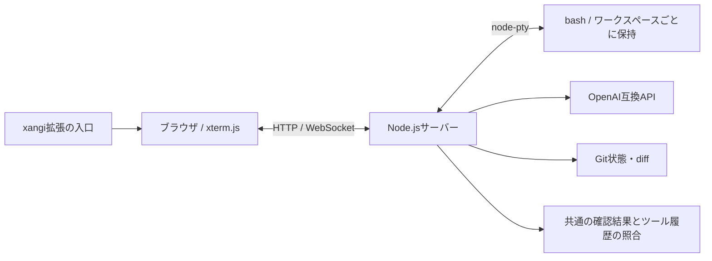

# 設計

## 構成

ブラウザでサーバー上のbashを操作する、本人用のターミナルです。AIはコマンドの提案と解説を担当し、通常のシェル操作はAIの応答を待ちません。

- `src/server.mjs`: 静的画面、認証、作業場所、AI提案のHTTP API。
- `src/terminal.mjs`: 認証付きWebSocketとPTY、出力制御、再接続とセッション終了。
- `src/platform.mjs`: OS名とシェルのcwd取得。Linuxは`/proc/<pid>/cwd`、macOSは`/usr/sbin/lsof -a -p <pid> -d cwd -F0n`を使用。PIDを引数として渡し、2秒・64KiBで制限する。取得失敗時はGit/AI確認を拒否し、古いcwdを使わない。
- `src/environment.mjs`: 直接接続LLM用のcwd直下メタデータ取得。
- `src/preview.mjs`: バックエンドの共通確認報告を検証し、状態と出力を表示用に整形。
- `src/git-status.mjs`: Gitの状態と差分を読み取る。
- `src/xangi.mjs`: xangiの登録ワークスペース・バックエンド・モデルの取得と、変換・解説用の実行依頼。
- `src/backends.mjs`: サーバー設定のLLM接続先の検証。
- `src/open.mjs`: ローカル用の一度限りの接続リンクを取得してブラウザを開く。
- `src/extension.mjs`: xangiの内部通信用トークンを検査し、利用者を設定URLへ移動させる。

ブラウザのコードは `public/`、起動スクリプトは `scripts/`、テストは `test/`、利用方法と設計は `docs/` に置きます。ルートにはREADME・パッケージ設定・拡張マニフェストを置きます。

## シェルとワークスペース

ログインセッションの中に最大8件のワークスペースを持ち、それぞれ独立したbashを使用します。cd・export・履歴はシェル内に残り、登録内容はログアウトやサーバー停止で失われます。`terminal/new`は現在のcwdから同じフォルダでも別IDのシェルを追加します。`terminal/close`は対象だけを終了し、最後のタブを閉じたら空のターミナルを用意します。同じIDへのブラウザ接続は最後に開いた画面が操作します。

認証の有効期間は8時間。タブ切り替えやブラウザ切断ではシェルを終了せず、出力を読み続けます。タブを閉じる・ログアウト・期限切れ・サーバー停止時に終了します。出力はACKによるフロー制御を行い、再接続用に直近256K文字を保存します。画面全体の完全復元やバックグラウンドジョブの常時稼働は保証しません。

## AI提案と結果プレビュー

入力が400ms止まると候補を生成します。IME変換中は待機し、古い応答を入力の世代番号で破棄します。自然言語欄と実行するコマンド欄は分け、コマンド欄の編集だけではAIを呼びません。

xangiへagentIdを渡し、選んだエージェントのワークスペース・役割指示・AI設定で起動します。terminalはbackend/model/effort/workspaceIdを上書きしません。入力・OS・シェル・実行対象のcwdをタスク本文で送り、仮想実行ではcwdを明示して調査・確認するよう依頼します。自然言語変換ではツールを使わず候補だけ生成します。選択エージェントの未登録時には失敗させ、実行対象のフォルダから起動先を推測しません。直接接続LLMに限り直下メタデータを送ります。入力・ファイル内の文章を命令として扱わないよう指定します。

コマンド名ごとの実行リストはありません。バックエンドが副作用を調べ、読み取り候補は全体を実行、変更候補は読み取り調査・dry-runで影響を確認します。結果はstatus（executed/dry-run/predicted/unavailable）、reason、checks（command/cwd/output/exitCode）で受け取ります。executedには候補とcwdが一致し終了コードのある報告を要求し、ツール履歴がない場合はunverified表示へ下げます。ツール履歴は出力を証明しないため、実行結果のラベルにはAI報告と明記します。

## 認証と実行権限

このアプリは本人用のサーバーシェルです。ログインした利用者は起動ユーザーの権限で任意コマンドを実行できます。共有sandboxではありません。

- HTTP/WSのHost・Origin・セッションを照合します。CookieはHttpOnly/SameSite=Strict、HTTPS時はSecureです。
- Tailscale本人認証は、loopbackのTailscale Serveが付けるユーザーヘッダーと設定値の一致を確認します。同じOS上のプロセスは信頼対象です。別のプロキシから任意のユーザーヘッダーを通さないでください。
- ローカル起動CLIは秘密キーで有効期限60秒・1回限りのリンクを取得し、ブラウザに渡します。URL fragmentはログイン時に取り除きます。OSの同じユーザーによるプロセス情報の閲覧までは防ぎません。
- 拡張入口はxangiの内部通信用トークンを検証し、loopback経由でterminalの一度限りの接続リンクを取得します。terminalの長期キーはブラウザへ渡しません。利用者のアクセス制御はxangiの拡張入口の公開範囲に従います。手動キー入力UIはありません。
- 公開範囲・Tailnet ACL・プロキシ設定は運用者が管理してください。インターネットへ無条件に公開するための構成ではありません。
- AI予想はsandbox検証ではありません。バックエンドに変更操作を禁止し、未知のスクリプトやdry-runの副作用を調べるよう指示します。権限はxangi側に従い、読み取り専用を技術的に保証するものではありません。

自動テストで認証拒否・Origin拒否・チケット再利用拒否などを検証していますが、全APIを対象にした第三者のセキュリティ監査は未実施です。

## UI

ユーザーは、自分のサーバーで何をするかを自然言語で入力し、コマンドの意味を確認して実行する。

参照: 暗色・細い境界・控えめな装飾。配色はターミナル向けに炭色とミントへ変更。特定ブランドのフォントや資産は使用しない。
品質の参照: https://github.com/Nutlope/hallmark と https://design.digital.go.jp/dads/ 。フォームラベル、フォーカス、操作状態、エラー文、タップ領域を重視。

- 背景 #101113、面 #181a1e、境界 #363a42、本文 #f1f3f5、補助 #a9b0bb、操作 #a7e8ce。CSS変数へ集約。
- 本文system-ui、出力monospace。本文15px、入力16px、タップ領域44px以上。
- 接続先とフォルダを最上段。左に入力・確認、右に実際の出力。800px以下は上部に常時表示のターミナル、下部にスクロールする入力・確認領域。
- 自然言語とコマンドは独立したラベル付き入力欄を同時表示。エラーはrole=alert、候補進捗はrole=status。
- 確認結果は状態ラベル付き。PTY出力は別領域。コマンド欄のEnterは即実行、Shift+Enterは改行。自然言語変換はツールを使わない候補生成を依頼し、仮想実行ボタンで環境確認を別途依頼する。変更候補は事前確認で実行しないよう指示する。直接操作はAIや確認を待たない。PTYで作業フォルダと環境変数を保持。
- PC/スマホとも、接続 → 入力 → コマンド欄へ生成 → 任意の解説 → 実行 → 出力 → 次の入力。自然言語の元入力はコマンド編集後も保持。
- 履歴のカード列やランディングページ的な装飾は作らず、操作と出力に面積を使う。

- 作業場所選択・追加・Git概要を接続情報直下の1行へ配置。詳細は閉じられるdialogへ置き、ターミナル常設を維持。Git情報は色だけで区別しない。
- モバイル/PCとも「追加→選択→直接実行→元の場所に戻る→状態保持」「Git概要→詳細/diff→閉じて入力」を成功条件とする。登録の有効期間とシェル保持期限は追加画面に明示。

- 入力欄のfocus枠は内側へ描画してスクロール境界による欠けを防ぐ。ターミナル外枠CSSはsection.terminalに限定し、xterm内部へ適用しない。PCは入力:ターミナル=1:2、スマホはターミナルと入力を切り替えて表示領域を確保する。低いviewportではヘッダーと接続情報を隠す。
- 結果は「実行済み（AI報告）」「dry-run」「予測」「確認不可」「履歴未確認」を区別し、参照cwdと取得方法を表示する。

## 現在の範囲

Linux・macOS/bash・本人利用を対象とし、SSH接続先の管理、永続ワークスペース登録は未実装です。依存ライブラリのLICENSEはnpmパッケージ内に保持し、ブラウザへ配信するxterm.jsとFitAddonには元のLICENSEをコメントとして付加します。利用手順は[usage.md](usage.md)を参照してください。

## バックエンド設定とxangi連携

LLM接続先はサーバーで設定し、ブラウザへはID・表示名・モデルだけを返します。認証セッションごとに選択したIDを保持し、自然言語変換・コマンド解説の両方をその接続先へ送ります。任意の接続先やAPIキーをブラウザから渡す入口はありません。選択変更で古い候補を破棄し、古いバックエンドIDのリクエストを拒否します。

直接接続のOpenAI互換APIと、xangiのバックエンドを扱います。xangiのruntime-settingsとmodelsを読み取り、Effortもモデル別supportedEffortsから表示・検証します。選択したbackend/model/effort/workspaceIdでagent-runsへ変換・解説用の依頼を送ります。登録エージェントや独立したチャットUIは使いません。xangiには履歴が残ります。localLlmModeは対応するバックエンドにだけ指定し、skipPermissionsはfalseです。

xangiのツールにはcwdの読み取り確認を依頼し、変更操作をしないよう指示します。技術的な読み取り専用の保証ではありません。確認手順と結果はバックエンドの報告として表示し、ツール呼び出し履歴の取得成否も明示します。候補生成は400ms debounceで自動開始し、環境確認は専用ボタンのみで開始します。IME変換中は待機し、処理中の更新は最新入力だけを保留します。古い回答はrevisionで破棄します。受理後のrun IDを認証セッション内に保持し、通信失敗時の同じ入力の再確認で再利用します。バックエンド変更は実行中・未回収の依頼がある場合に拒否します。

ワークスペースの登録内容は読み取りのみです。登録一覧からIDで照合し、同じサーバー上の実在ディレクトリをterminalセッションへ追加します。設定UIは上部の「AI」ボタン、登録済みワークスペースは上部の選択欄へ自動表示し、選択時にシェルを用意します。未登録フォルダだけ「＋ フォルダ」から追加します。ターミナルは常設します。

## 単発AI依頼の終了

コマンド変換・事前確認のrunが成功または失敗したら、呼び出し元が既存の `POST /api/sessions/:id/close` で履歴を残してセッションを終了する。forceは送らない。回答が不正な場合も終了対象とする。終了APIが失敗した場合は完了結果とrun IDを保持し、同じ入力の再確認では終了処理だけ再試行してAIを再実行しない。処理中・受信タイムアウトではセッションを閉じない。

## ターミナルタブのUI

既存の暗色・ミントの配色、44px操作領域を保ち、上部に横スクロールのタブ列と固定の追加ボタンを置きます。選択中は下線と文字色で示し、各タブの終了ボタンは独立したラベルを持ちます。キーボードの左右/Home/Endでフォーカスを移動し、Enterで選択します。PC・スマホとも追加→入力→切り替え→元へ戻る→閉じるを同じ順で使います。GitとAIの確認対象は選択中のタブです。切り替え中の古いAI応答は破棄し、下書きはタブごとにブラウザ内で保持します（ページ再読込では消えます）。
